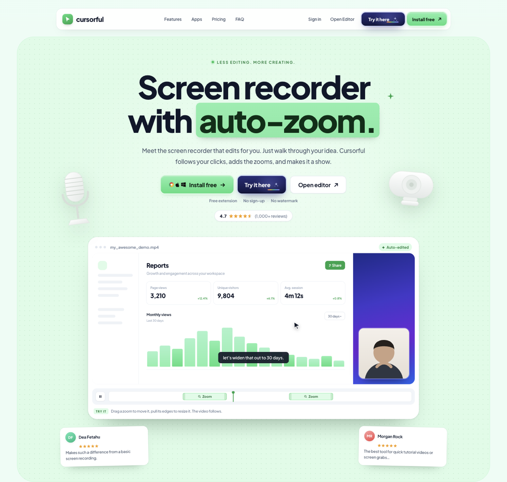

# Cursorful homepage study



A static, dependency-free reconstruction of the [cursorful.com](https://cursorful.com/) homepage: the marketing site for an auto-zoom screen recorder.

This is a design and front-end study. It is not affiliated with, endorsed by, or connected to Cursorful. All product names, copy, and marks belong to their owners. Photos, video, and brand logos from the original site are deliberately not copied; the previews are drawn in CSS and inline SVG instead.

## Run it

No build step, no install:

```bash
python3 -m http.server 8899
# open http://127.0.0.1:8899
```

Opening `index.html` directly with `file://` also works, since there are no module imports or fetches.

## What is in here

| File | Purpose |
| --- | --- |
| `index.html` | All markup for the page, one document, semantic sections |
| `styles.css` | Design tokens plus layout, components, and breakpoints |
| `app.js` | Progressive enhancement: nav, sliders, accordions, cursor demos |
| `favicon.svg` | App mark used in the tab |

No frameworks, no bundler, no tracking, no network calls except the Google Fonts stylesheet for Plus Jakarta Sans (with a system fallback).

## Sections

1. Floating nav pill with sticky shadow
2. Hero with the interactive recorder mockup, draggable zoom segments, and two pinned review cards
3. How it works, three steps with CSS wireframe art
4. Trusted-by logo strip
5. Look panel: preset, aspect ratio, background, camera layout, and browser frame all re-render the preview
6. Feature bento, twelve cards with hand-built mini demos
7. Cursor effects: three live demos that follow the pointer with smoothing, scaling, and motion blur
8. Platform cards, light and dark
9. Reviews wall with tilted cards and tape strips
10. Pricing with a working seat stepper
11. FAQ accordion
12. Closing call to action
13. Footer with four link columns

## Behaviour

Everything is progressive. With JavaScript disabled the page still renders, the accordion uses native `<details>`, and every control remains readable. Adding JS turns on:

- sticky nav shadow and a mobile menu with `aria-expanded`
- reveal-on-scroll for cards, skipped under `prefers-reduced-motion`
- drag to move a zoom segment, drag its edges to resize, arrow keys to nudge
- the look panel preview state machine
- seat stepper, with per-seat total and preset pills
- pointer-following cursor demos, each with its own motion model

## Design tokens

Sampled from the live site's computed styles, then re-expressed as variables:

```css
--paper: #ecfdf5;   /* page background */
--mint:  #dcfce7;   /* canvas, chips, camera tiles */
--line:  #bbf7d0;   /* hairlines */
--ink:   #0f172a;   /* headings, dark plans */
--body:  #4b5563;   /* running text */
```

Type is Plus Jakarta Sans, weight 500 for body and 800 for headings, with tight negative tracking (`-0.045em` at display sizes). Cards use a 24px radius with a layered shadow (1px ring, 2px ambient, 16px spread). Buttons are 38, 44, or 50px tall with a 12px radius; the green action carries a 3px mint ring, and the dark action carries an indigo glow.

## Responsive rules

- `1180px`: hero illustrations tuck inward
- `1024px`: nav text links drop, feature grid halves, pricing stacks
- `900px`: hamburger menu, demo sidebar hides, steps go vertical
- `640px`: single column everywhere, smaller display type, stacked plans

## How the reconstruction was checked

Layout, spacing, and colour came from measured values rather than eyeballing:

1. Recorded the live page through Chrome DevTools Protocol (page structure, resources, accessibility tree, computed styles) using the REA toolkit.
2. Read computed styles for the display type, body copy, nav pill, both button variants, the feature card, the pro plan, the CTA banner, and the page canvases.
3. Rebuilt each section from those values, then compared screenshots at 1440px and 390px and corrected the differences.

Where the original uses photography (webcam tiles, reviewer avatars, device shots), this version uses CSS gradients, inline SVG silhouettes, and initials, so the repository carries no third-party media.

## License

MIT for the code in this repository. See `LICENSE`.
