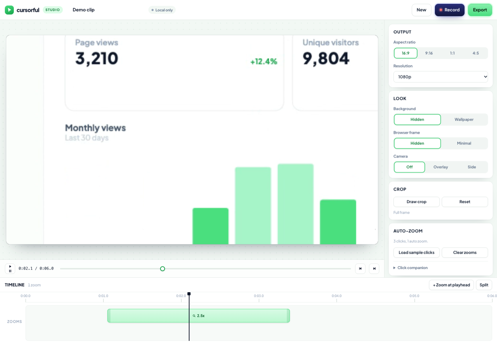

# Cursorful: homepage study and a working studio

A reconstruction of the [cursorful.com](https://cursorful.com/) homepage, plus the actual thing the homepage is selling: a screen recorder that turns your clicks into zooms, lets you retune them on a timeline, and renders the result locally.



The marketing page is a design study. The studio is real software.

## Run it

ES modules need an HTTP origin, so open it through a server, not `file://`:

```bash
python3 -m http.server 8899
```

| Page | URL |
| --- | --- |
| Landing page | http://127.0.0.1:8899/ |
| Studio | http://127.0.0.1:8899/studio/ |

Chrome or Edge gets you MP4 export and screen capture. Safari works too, with MP4 only.

## What the studio does

1. **Record** a tab, window, or screen with `getDisplayMedia`, optionally with microphone and camera. Audio is mixed through a Web Audio graph so the tab and your voice end up on one track.
2. **Auto-zoom** from clicks. Clicks are clustered, and each burst becomes a zoom segment on the timeline.
3. **Edit** on a timeline: drag a zoom, pull its edges, change its depth, move its focus point, crop the frame, pick an aspect ratio, and style the camera tile.
4. **Export** an MP4 or WebM with the zooms baked in.

Everything stays on your machine. There is no backend, no upload, and no account.

### Try it without recording anything

Press **Generate a 6s demo clip**. It renders a synthetic dashboard in real time, loads it into the editor, and runs the auto-zoom engine over sample clicks so you can see a zoom placed, scrubbed, and exported. That path is also how the automated checks exercise the editor.

## How auto-zoom actually works

The rule matches the behavior documented on Cursorful's own FAQ page: two or more clicks inside a three second window open a zoom, and the zoom is held while clicks keep arriving.

```js
// clicks.js: chained clustering
while (j + 1 < sorted.length && sorted[j + 1].t - sorted[j].t <= 3) j += 1;
```

Each cluster becomes a segment with a focus point (the click centroid in source pixels), a padded time window, and a depth derived from how tightly the clicks were grouped.

The camera is a source rectangle sampled per frame, not a CSS transform, so the export and the preview cannot diverge:

```js
// zoom.js
const scale = 1 + (depth - 1) * easeInOut(progress);
const w = base.w / scale, h = base.h / scale;
const cx = clamp(lerp(baseCx, focus.x, k), base.x + w / 2, base.x + base.w - w / 2);
```

That clamp is the whole trick. Without it the camera pulls past the edge of the recording and the zoom jolts.

## The click companion

A page cannot see clicks that happen in another tab. That is a browser boundary, not a shortcut. To get real clicks, load the small MV3 extension in `extension/`:

1. Open `chrome://extensions`, turn on **Developer mode**.
2. Choose **Load unpacked** and select the `extension/` folder in this repo.
3. Start the local server, then open the studio once so the origin is known.
4. Open the tab you want to record, click the companion's toolbar button, and it focuses this studio and arms a session.
5. Press **Record** in the studio, pick that same tab in the Chrome picker, and click through your demo.
6. Press **Stop**. The studio collects the click log and places the zooms.

The companion buffers `pointerdown` positions in the recorded tab and hands the whole log over once, on stop. Timestamps are absolute `Date.now()` values, aligned against the recording start on the same machine.

The studio does not need to know the extension id. The background worker injects a small bridge into the studio tab and relays requests over `postMessage`, so a studio tab that was already open reconnects as soon as the session arms.

Without the extension the studio still works. It just cannot auto-place zooms, so you add them at the playhead or load sample clicks.

### Checking the connection

The Auto-zoom panel shows whether the companion is reachable:

| Badge | Meaning |
| --- | --- |
| Not detected | The extension is not installed, or the tab was never injected |
| Connected | The bridge answered, no capture session is armed |
| Capturing | A session is armed and buffering clicks |

Press **Test companion** after loading the extension. If it still says Not detected, reload the studio tab so the bridge can be injected, and confirm the extension is enabled at `chrome://extensions`.

If no clicks arrive after a recording, the timeline shows a persistent notice instead of a toast that disappears. **Companion steps** opens the install list.

### Importing a click log

Auto-zoom can be exercised without the extension. **Import clicks** accepts JSON:

```json
[{ "x": 400, "y": 300, "t": 0.8 }, { "x": 420, "y": 320, "t": 1.2 }]
```

`x` and `y` are source pixels, `t` is seconds from the start of the clip. Clusters are built with the same three second rule.

### One honest limitation

Click coordinates are captured in CSS pixels of the tab viewport, so auto-zoom assumes you recorded **that tab**, not the whole screen. If the video's aspect ratio does not match the tab viewport, the studio refuses to auto-place zooms and tells you why. Manual zooms still work. Recording the desktop properly is what Cursorful's paid desktop app is for.

## Export

`MediaRecorder` runs over `canvas.captureStream(30)` with the audio track mixed in, and the format is probed rather than promised:

```
video/mp4;codecs=avc1.42E01E,mp4a.40.2   -> MP4
video/webm;codecs=vp9,opus               -> WebM
video/webm;codecs=vp8,opus               -> WebM
```

The dialog shows the format you are actually going to get. Export renders in real time, so a 30 second clip takes about 30 seconds. 1080p is the default; 1440p and 4K are available but will drop frames on slower machines.

Verified with `ffprobe` on a real export: H.264, 1280x720, 30 fps, AAC audio, 6.0 seconds, and the zoom is baked into the frames.

## Editor controls

| Action | How |
| --- | --- |
| Play or pause | Space, or the transport button |
| Select a zoom | Click it on the timeline |
| Move a zoom | Drag it |
| Resize a zoom | Drag either edge |
| Nudge a zoom | Arrow keys (Shift for larger steps) |
| Delete a zoom | Delete or Backspace |
| Add a zoom | `+ Zoom at playhead`, or double-click the lane |
| Split a zoom | Put the playhead inside it, then `Split` |
| Move focus | Select a zoom, `Set focus`, then click the preview |
| Draw a crop | `Draw crop`, then drag a rectangle |
| Export | `Cmd/Ctrl + E`, or the Export button |

## Layout

```
index.html                 landing page, CTAs open the studio
styles.css                 landing page styles
app.js                     landing page interactions
studio/
  index.html               recorder and editor shell
  studio.css               app UI styles
  js/capture.js            display, mic, camera capture and audio mixing
  js/clicks.js             clustering and sample click data
  js/zoom.js               camera math, segment generation, output sizes
  js/render.js             one drawFrame used by preview and export
  js/timeline.js           ruler, lanes, drag and resize
  js/export.js             codec probe, canvas and audio mux, encode
  js/store.js              IndexedDB projects and blobs
  js/demo.js               synthetic clip generator
  js/main.js               wiring and state
extension/
  manifest.json            MV3, activeTab plus scripting
  background.js            sessions, click buffering, studio handoff
  content.js               pointerdown capture and batching
```

Projects autosave to IndexedDB, including the video blob, so a reload restores your timeline, crop, aspect, and camera settings.

## What is not here

Share links need a backend, so export is a file, not a URL, and the site does not pretend otherwise. Captions, denoise, and speed segments are separate features with real weight; they are not half-built here. Faster than real time export needs WebCodecs and an MP4 muxer, which is a v2.

## Verification

Automated through the Chrome DevTools Protocol against the built app:

- record, stop, collect clicks, and place a zoom from a stubbed companion session
- drag a segment (start moved 1.05s to 1.55s) and change depth (2.5x to 2.9x)
- crop by drawing on the preview (60% by 60% from 20%, 20%)
- switch aspect to 9:16 and confirm the canvas becomes 608x1080
- export to MP4 and decode the file with `ffmpeg`, then extract frames to confirm the zoom is in the pixels
- cancel an export midway twice and confirm the dialog resets to Close with no file produced
- connect through a stubbed bridge, show idle and capturing states, then record, collect, and place a zoom
- record with no companion and confirm the empty-recording notice appears
- import a click log through the file input and place zooms from it
- reload and confirm the project, segments, depth, crop, and aspect are restored

## Landing page

The homepage keeps its measured design tokens: `#ecfdf5` paper, `#dcfce7` canvas, Plus Jakarta Sans at weight 800 with tight tracking, 24px cards with layered shadows, and the 40px grade on synthetic screenshots. Photos from the original site were not copied; previews are drawn in CSS and SVG.

## License and disclaimer

MIT for the code. This is an unofficial study and is not affiliated with Cursorful. The Cursorful name, marks, and marketing copy belong to their owners. See `LICENSE`.
